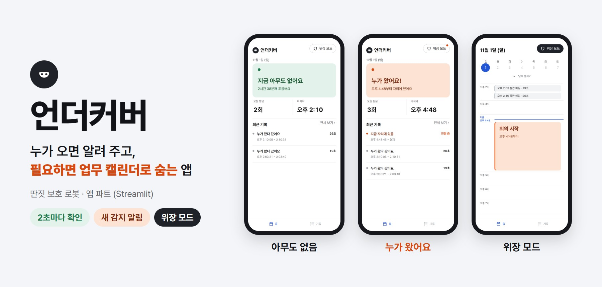
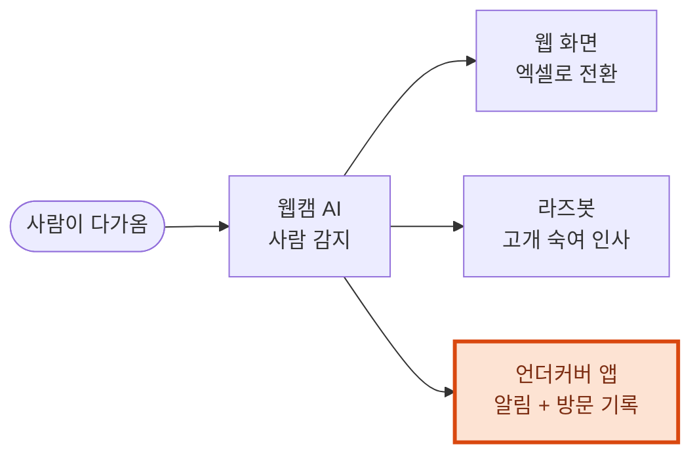
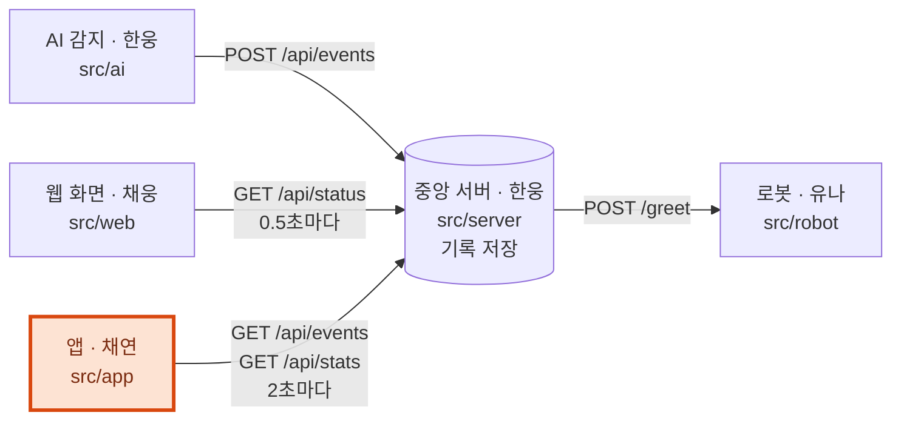
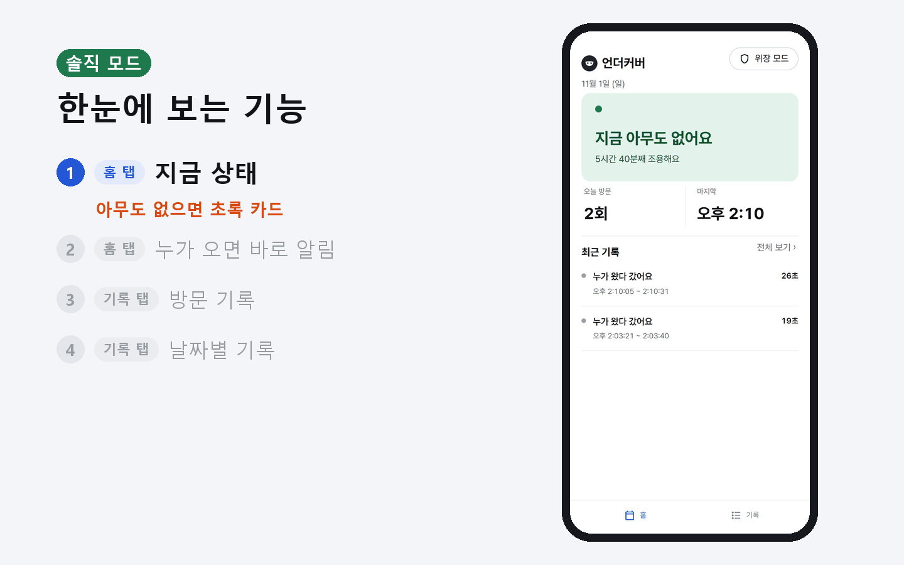
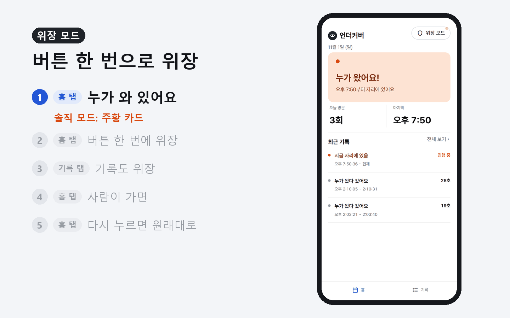
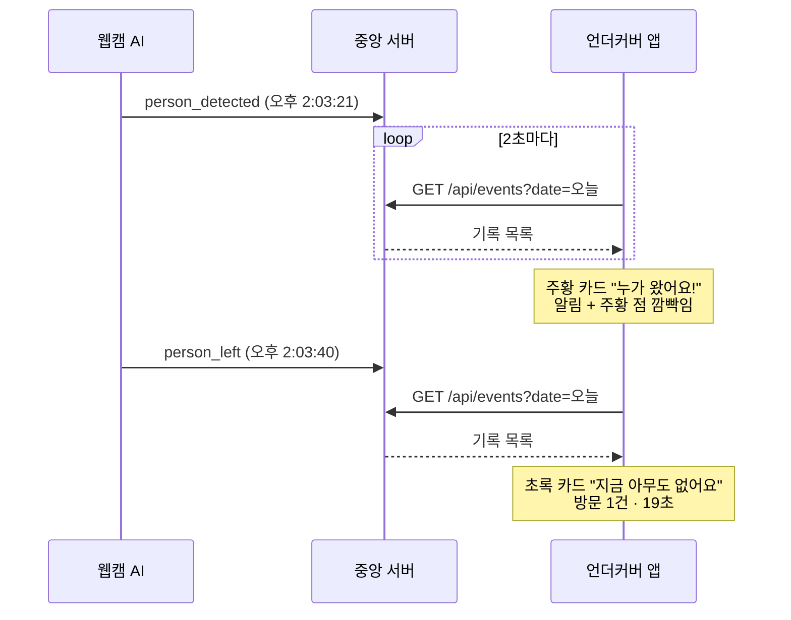
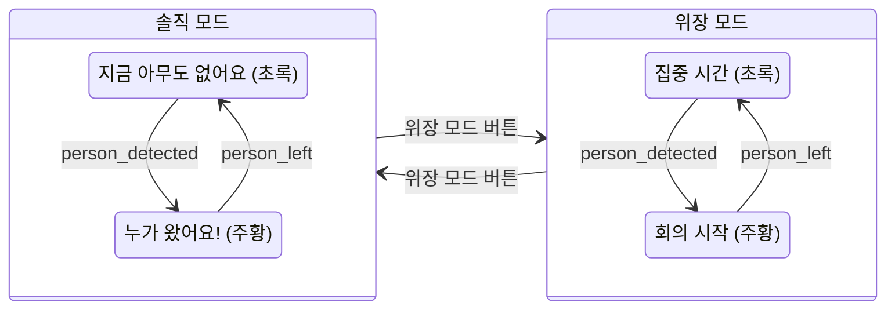

# 언더커버



| 담당 | 도구 | 규격 | 화면 설계 | 진행 상황 |
|:---:|:---:|:---:|:---:|:---:|
| 채연 | Streamlit (Python) | [`design.md` ④](../../docs/design.md) | [`SCREEN.md`](SCREEN.md) | [`M4-app.md`](../../docs/milestones/M4-app.md) |

## 1. 무엇을 하는 프로젝트인지



## 2. 각 부분이 어떤 역할을 하는지



## 3. 어떤 기능을 포함하는지

### 솔직 모드



### 위장 모드



| 실제 상태 | 위장 모드에서 보이는 말 |
|:---:|:---:|
| 아무도 없음 | 집중 시간 |
| 누가 와 있음 | 회의 시작 |
| 누가 왔다 감 | 잠깐 미팅 |
| 방문 기록 | 미팅 기록 |

## 4. 결과물에는 어떤 것이 있는지

```
src/app/
├── app.py       화면: 홈 · 기록 · 위장 모드 · 알림 · 서버 연결
├── visits.py    계산: 방문 묶기 · 지금 상태 · 횟수
├── style.css    디자인: 색 · 글꼴 · 핸드폰 폭
├── SCREEN.md    화면 설계서
└── design/      시안 · README 이미지
```

## 5. 예시는 어떤 것이 있는지

한 사람이 왔다 갔을 때 앱 화면이 바뀌는 순서



## 6. 프로젝트 전반의 흐름

앱 화면이 바뀌는 규칙



## 7. 실행 방법

```
pip install -r requirements.txt
streamlit run src/app/app.py
```

| 상황 | 하는 법 |
|---|---|
| 휴대폰으로 보기 | 같은 Wi-Fi 에서 터미널의 `Network URL` 접속 |
| 실제 서버 연결 (11/2) | `$env:SERVER_HOST="서버IP"; streamlit run src/app/app.py` |
| 끄기 | 터미널에서 `Ctrl + C` |
