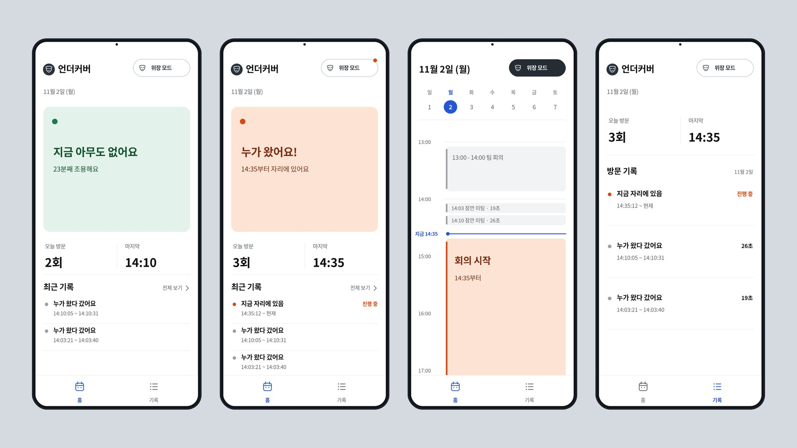
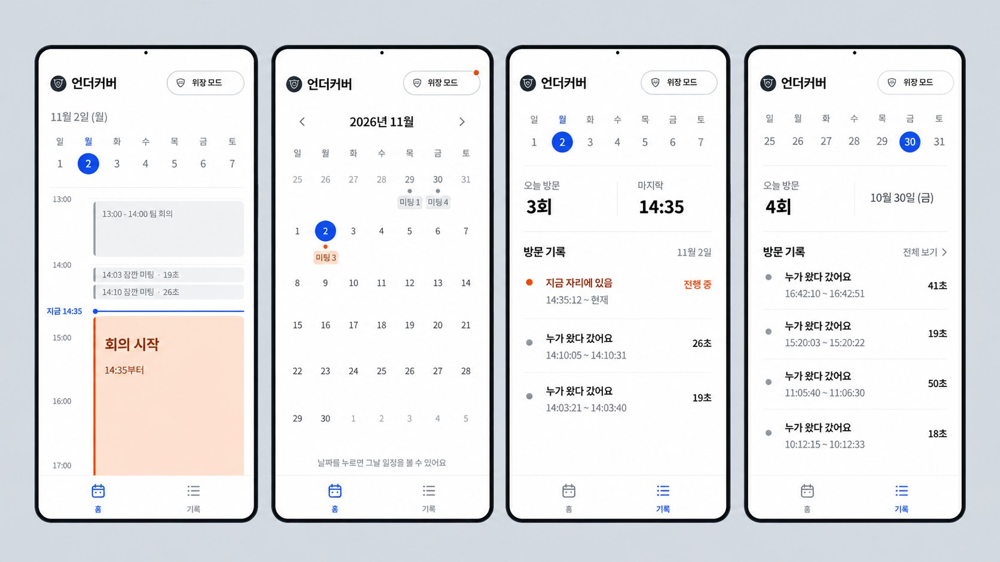

# 앱 화면 설계 (10/31 확정)

## 시안

기본 화면: 솔직 홈(안전) / 솔직 홈(누가 옴) / 위장 홈 / 솔직 기록



날짜 동작: 위장 홈 처음 / 위장 홈 아래로 내림(한 달 달력) / 솔직 기록 오늘 / 솔직 기록 지난 날짜



시안과 다르게 만든 부분
- 위장 모드 화면에는 "언더커버" 이름 대신 날짜를 제목으로 둡니다. (위장이 깨지지 않게)
- 가짜 일정("팀 회의")은 넣지 않습니다. 실제 감지 기록만 일정으로 보여줍니다.
- 지난 날짜의 횟수 제목은 "오늘 방문"이 아니라 "방문"입니다.
- 지난 날짜를 볼 때 기록 제목 오른쪽에 "오늘로" 버튼이 나옵니다.

## 1. 컨셉

언더커버: 내 자리에 누가 오면 알려 주는 앱.
평소에는 솔직하게 보여주고, 누가 볼 것 같으면 "위장 모드"를 켜서 평범한 업무 캘린더로 바꿉니다.

## 2. 화면 구성

```
[솔직 모드]                         [위장 모드]
 홈: 상태 카드     --위장 모드 켜기-->  홈: 캘린더
 기록: 방문 기록                       기록: 미팅 목록
                  <--위장 모드 끄기--
```

- 탭 2개: 홈 / 기록 (아래 탭 바)
- 위장 모드는 켜고 끄는 스위치. 켜면 홈과 기록이 모두 위장 화면이 되고, 끌 때까지 유지됩니다.
- 위장 모드는 사용자가 직접 켜고 끕니다. 자동으로 바뀌지 않습니다.
- 위장 모드 버튼: 꺼짐 = 흰 바탕 테두리, 켜짐 = 검은 바탕. 위장 모드가 꺼진 상태에서 사람이 있으면 버튼에 주황 점이 1.2초 간격으로 깜빡입니다. (휴대폰의 "동작 줄이기" 설정이 켜져 있으면 깜빡이지 않음)

## 3. 솔직 모드

### 홈

| 상태 | 조건 | 상태 카드 |
|---|---|---|
| 안전 | 오늘 마지막 기록이 `person_left` | 초록. "지금 아무도 없어요" / "N분째 조용해요" |
| 누가 옴 | 오늘 마지막 기록이 `person_detected` | 주황. "누가 왔어요!" / "14:35부터 자리에 있어요" |
| 기록 없음 | 오늘 기록이 없음 | 초록. "오늘은 아직 아무도 안 왔어요" |

- 상태 카드 아래: "오늘 방문 N회", "마지막 HH:MM"
- "최근 기록" 3개, "전체 보기"를 누르면 기록 탭으로 이동
- 상태 카드 아래쪽 빈 공간은 줄입니다. (시안에서 카드 아래 절반이 비어 있음)

### 기록

- 위에 이번 주 날짜 줄과 "달력 펼치기". 누르면 한 달 달력만 보이고(위장 홈과 같은 방식, 날짜 밑에 "방문 3"), 날짜를 누르면 그날 기록으로 돌아옵니다. (REQ-02)
- 솔직 모드 홈은 오늘만 보여줍니다.
- 감지 두 개(`person_detected` + `person_left`)를 방문 한 건으로 묶어서 보여줍니다. 최신이 위.
  - 끝난 방문: "누가 왔다 갔어요" / "14:10:05 ~ 14:10:31" / 오른쪽에 "26초"
  - 진행 중: 주황 점, "지금 자리에 있음" / "14:35:12 ~ 현재" / 오른쪽에 "진행 중"
- 신뢰도(%)는 보여주지 않습니다.
- 기록이 없는 날: "이날은 방문 기록이 없어요" (REQ-04)

## 4. 위장 모드

화면에 "방문, 사람, 감지" 같은 단어를 쓰지 않습니다.

### 홈 (캘린더)

- 날짜, 주간 날짜 줄, 시간 칸
- 가짜 일정은 넣지 않습니다. 실제 감지 기록만 일정으로 보여주고, 새 감지가 오면 바로 반영합니다.
  - 끝난 방문: 회색 작은 일정 "14:10 잠깐 미팅 · 26초"
  - 지금 상태 블록 (오늘만, 끝 시각 없이 아래로 이어짐)
    - 안전: 초록 "집중 시간" / "14:11부터"
    - 누가 옴: 주황 "회의 시작" / "14:35부터"
- 파란 현재 시각 선 "지금 14:33"
- 화면은 미팅이 있는 시간과 지금 시각 근처(1시간 전 ~ 3시간 후)만 보여주고, 사이 빈 시간은 "···" 한 줄로 줄입니다.
- 이번 주 날짜 줄에서 날짜를 누르면 그날 일정을 보여줍니다. 날짜 줄 아래 "달력 펼치기"를 누르면 한 달 달력만 보이는 화면으로 바뀌고, 날짜 밑에 그날 횟수가 작게("미팅 3") 나옵니다. 달력에서 날짜를 누르면 그날 일정 화면으로 돌아오고, "접기"를 눌러도 돌아옵니다. 오늘 이후 날짜는 누를 수 없습니다.

### 기록

- 솔직 모드 기록과 화면이 같고 글자만 바꿉니다.
  - 오늘 방문 -> 오늘 미팅, 방문 기록 -> 미팅 기록
  - 지금 자리에 있음 -> 지금 미팅 중, 누가 왔다 갔어요 -> 잠깐 미팅
  - 이날은 방문 기록이 없어요 -> 이날은 미팅 기록이 없어요
- 맨 위 제목은 "언더커버" 대신 날짜
- 테스트 버튼은 위장 모드에서도 똑같이 보입니다.

## 5. 알림

- 새 `person_detected` (마지막으로 본 `id` 보다 큰 것)가 오면 화면 아래에 알림
  - 솔직 모드: "누가 왔어요! 14:35"
  - 위장 모드: "회의 시작 14:35"
- 앱을 처음 열었을 때는 이미 있던 기록으로 알림을 띄우지 않습니다.
- 브라우저를 열어 둔 동안만 알림이 뜹니다. 소리, 진동은 없습니다.

## 6. 서버 연결

- 2초마다 `GET /api/events`, `GET /api/stats` 로 갱신
- 서버 연결이 안 되면 샘플 데이터(`data/sample_events.json`)로 보여주고 위쪽에 한 줄 표시
  - 솔직 모드: "서버 연결 안 됨 · 샘플 데이터"
  - 위장 모드: "동기화 안 됨"
- 테스트 버튼("가짜 왔어요", "가짜 갔어요"): 서버 연결 전 테스트 기간에만 둡니다. 서버 연결이 안 될 때만 기록 탭 맨 아래에 보입니다.

## 7. 계산 규칙 (서버 규격은 그대로, 앱에서 계산)

| 화면 값 | 계산 |
|---|---|
| 지금 상태 | 오늘 마지막 이벤트 종류 |
| N분째 조용해요 | 지금 - 마지막 `person_left` 시각 |
| 방문 한 건 | `person_detected` 와 그다음 `person_left` 를 묶음 |
| 머문 시간 | `person_left` 시각 - `person_detected` 시각 |
| 오늘 방문 N회 | `GET /api/stats` 의 `count` (실패하면 `person_detected` 개수) |

예외
- `person_detected` 뒤에 `person_left` 없이 날짜가 바뀜: 지난 날짜에서는 "종료 기록 없음"
- `person_left` 만 있음: 방문으로 묶지 않고 머문 시간 "-"
- `person_detected` 가 연달아 옴: 마지막 것 기준

## 8. 디자인

- 배경 흰색, 글자 #111111 / #5F6368, 구분선 #ECECEC
- 안전: 초록 #1E7A4C, 배경 #E3F2EA / 누가 옴: 주황 #D9480F, 배경 #FDE3D3
- 강조(탭, 현재 시각 선, 선택 날짜): 파랑 #2457D6
- 글꼴: Pretendard (없으면 Noto Sans KR), 시간·숫자는 폭이 같은 숫자
- 시간은 12시간제: "오후 2:03", 기록은 "오후 2:10:05 ~ 2:10:31" (오전/오후가 같으면 뒤쪽은 뺌), 일정표 시간 칸은 "오후 2시"
- 위장 홈 일정표: 일정 칸과 상태 블록 오른쪽에 12px 여백, 파란 "지금" 선만 끝까지
- 화면 폭 최대 420px 가운데 정렬, 좌우 여백 20px
- 그라데이션, 그림자, 이모지 없음

## 9. Streamlit 한계

- 길게 누르기, 밀어서 넘기기(위로 올려 달력 펼치기) 없음. 전부 누르기로 동작 ("달력 펼치기" / "접기" 버튼)
- 아래 탭 바는 CSS로 화면 아래에 고정
- 알림은 화면 안 토스트만 가능
